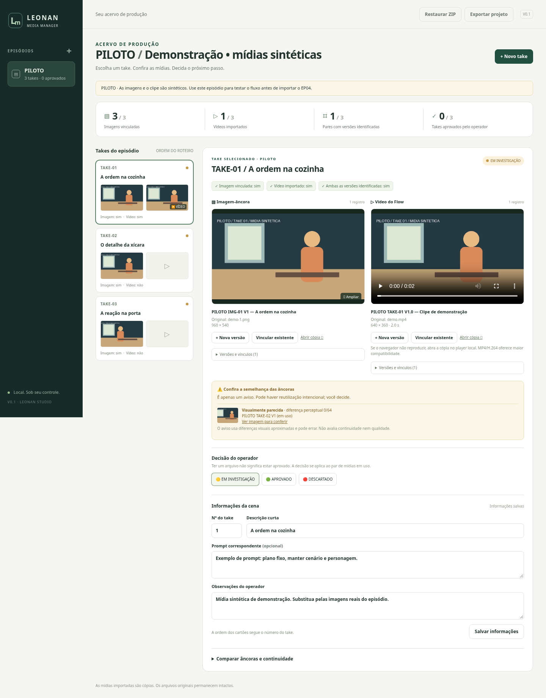

# LEONAN MEDIA MANAGER · V0.2 — exclusão segura

Um acervo local para episódios animados produzidos no Google Flow.

**Escolher episódio → escolher take → ver imagem correta → ver vídeo correto → conferir progresso.**

Python + Flask + Pillow + SQLite + FFmpeg. Funciona no navegador do próprio computador; não envia mídias, prompts ou observações a serviços externos. Internet é necessária apenas para a instalação inicial das ferramentas/dependências.

## Estado desta entrega

**🟡 EM INVESTIGAÇÃO — revisão pendente.** A V0.1 foi informada como funcional no Windows pelo operador. A V0.2 adiciona exclusão de episódios/takes, mantendo o mesmo esquema SQLite, a interface e os fluxos existentes. Não foi instalada nem executada no acervo principal ou no notebook do operador.

Se já usa V0.1, leia primeiro **[Migração segura para Windows](docs/MIGRACAO_V02_WINDOWS.md)**. Não extraia por cima do programa antigo, não substitua `data` e não use backups originais como pasta de trabalho. O teste final com o acervo real depende de revisão do ADM e autorização expressa do operador.

- [Como excluir com segurança e o que acontece com os órfãos](docs/EXCLUSAO_SEGURA_V02.md)
- [Resultados e limites da validação](docs/VALIDACAO_V02.md)

## Comece aqui no Windows

Este ZIP contém o código completo do aplicativo. Python e FFmpeg são instalados separadamente; não é necessário comprar nenhum programa.

1. **Extraia o ZIP.** Clique com o botão direito em `LEONAN_MEDIA_MANAGER_V0.2.zip` e escolha **Extrair Tudo**. Abra a pasta extraída `LEONAN_MEDIA_MANAGER_V0.2`. Não tente executar de dentro do ZIP. Prefira uma pasta onde você pode salvar arquivos, como Documentos.
2. **Instale Python.** Baixe o Python 3.12 de 64 bits em [python.org](https://www.python.org/downloads/windows/). No instalador, mantenha o **Python Launcher** (`py`) e marque **Add python.exe to PATH**. Se já tem Python 3.11 ou superior instalado, confira no Terminal: `py -3 --version`.
3. **Instale FFmpeg.** Abra o Terminal ou PowerShell do Windows e execute:

   ```powershell
   winget install --id Gyan.FFmpeg --exact
   ```

   Se `winget` não existir, instale/atualize o **Instalador de Aplicativo** da Microsoft Store e tente novamente. Depois da instalação, feche e reabra o Terminal. Os comandos `ffmpeg -version` e `ffprobe -version` precisam mostrar uma versão.
4. **Somente após autorização para o teste**, abra um Terminal na pasta nova e execute com caminho explícito para a cópia de dados:

   ```powershell
   py -3 iniciar.py --port 8767 --data-dir ".\data"
   ```

   Para abrir o terminal na pasta: no Explorador de Arquivos, clique na barra de endereço, digite `powershell` e pressione Enter. A pasta correta contém `iniciar.py`, `app.py` e `requirements.txt`.
5. **Aguarde a primeira abertura.** O iniciador cria o ambiente `.venv`, instala as dependências e abre o navegador. Essa primeira etapa precisa de internet. Nas próximas aberturas, o aplicativo funciona localmente sem conexão.
6. **Valide em acervo isolado.** Em um acervo vazio de teste, use **Conhecer com um piloto** para criar mídias sintéticas. Se usa uma cópia do acervo existente, siga o roteiro de migração e confira os registros antes de qualquer exclusão. Nenhum teste desta entrega autoriza excluir o PILOTO real.

Mantenha a janela do terminal aberta durante o uso. Para encerrar, pressione **Ctrl+C** nessa janela. Seu registro fica salvo na pasta `data` e volta ao abrir o programa novamente.

No teste acima, o endereço é `http://127.0.0.1:8767`, no próprio computador. Se a porta estiver ocupada, escolha outra livre e ajuste o comando, sem reutilizar instâncias de produção. O atalho **Abrir no Windows.bat** usa os padrões (porta 8765 e configuração local); para a migração, prefira o comando explícito acima.

Se aparecer “`py` não é reconhecido”, reinstale o Python com o Launcher e abra um terminal novo. Não é necessário ativar ambientes virtuais nem alterar a política de execução do PowerShell.

**Validação da entrega:** a V0.1 já funcionou no Windows segundo o operador. O iniciador continua aceitando `py -3 iniciar.py` e usa `.venv\Scripts\python.exe` no Windows. Os testes novos da V0.2 foram executados em Linux, Python 3.12 e Chromium, com dados sintéticos temporários. O teste nativo da V0.2 no Windows e a restauração dos backups reais permanecem pendentes de autorização.

## Instalar e abrir

Requisitos: **Python 3.11+** (3.12 recomendado), **FFmpeg com ffprobe** no PATH e navegador atual. Use Chrome, Edge ou Firefox; MP4 com H.264 oferece a melhor compatibilidade de vídeo.

1. Baixe/clône este repositório e abra sua pasta.
2. Instale Python e FFmpeg:

   | Sistema | Preparação |
   | --- | --- |
   | Windows | Instale Python de [python.org](https://www.python.org/downloads/), incluindo o launcher `py`. Instale FFmpeg com `winget install --id Gyan.FFmpeg --exact`. Reabra o terminal após instalar. |
   | macOS | Com Homebrew instalado: `brew install python ffmpeg`. |
   | Ubuntu/Debian | `sudo apt update` e `sudo apt install python3 python3-venv ffmpeg`. |

3. Na pasta do projeto, execute:

   ```sh
   # Linux / macOS
   python3 iniciar.py
   ```

   ```powershell
   # Windows
   py -3 iniciar.py
   ```

O iniciador prepara `.venv`, instala as versões de `requirements.txt` quando necessário e abre o navegador. Depois dessa preparação, as aberturas funcionam offline. No Windows também pode dar dois cliques em **Abrir no Windows.bat**. No Mac, execute `chmod +x "Abrir no Mac.command"` uma vez para usar o atalho.

Mantenha o terminal aberto. **Ctrl+C** encerra o aplicativo sem apagar o registro. Abra novamente pelo mesmo comando para continuar.

O endereço **no seu computador** é `http://127.0.0.1:8765`. Se a porta estiver ocupada, use `python3 iniciar.py --port 8766` (ou `py -3 iniciar.py --port 8766`). O aplicativo aceita somente acesso local.

## Primeiro contato: piloto de 3 takes

Na tela inicial, clique em **Conhecer com um piloto**. Ele é criado localmente, uma única vez, com:

- TAKE-01: uma imagem e um clipe MP4 de 2 segundos;
- TAKE-02: uma âncora parecida com a primeira, para conferir o aviso;
- TAKE-03: outra âncora e nenhum vídeo, para mostrar a pendência objetiva.

Todas essas mídias são **sintéticas de demonstração**, feitas com formas geométricas; não são material do EP04 nem conteúdo gerado por IA. Nenhum take começa aprovado.

Teste o percurso: selecione TAKE-01, amplie a imagem, reproduza o vídeo, confira os indicadores e marque sua decisão. Depois selecione TAKE-02: a ausência do vídeo deve ficar evidente. Abra **Comparar âncoras e continuidade** para ver as imagens em uso na ordem do roteiro.



## Importar o EP04 real

1. Use **+** ao lado de Episódios. Informe `EP04` e um título opcional.
2. Crie os takes com seus números do roteiro e descrições curtas. Os cartões seguem a ordem numérica; o número pode ser corrigido em **Informações da cena**.
3. Selecione o take correto. Em **Imagem-âncora**, clique em **Importar** e escolha o arquivo, qualquer que seja o nome original. Informe a versão se souber.
4. Em **Vídeo do Flow**, importe o vídeo correspondente. Não é preciso misturar imagens e vídeos numa mesma pasta de trabalho: o aplicativo identifica seus tipos e os apresenta em campos separados.
5. Cole o prompt e as observações quando existirem. **Salvar informações** grava os campos; ao executar outra ação no aplicativo, alterações pendentes também são salvas. Campos inválidos impedem a troca até serem corrigidos.
6. Confira imagem, vídeo e versão; escolha manualmente **🟢 APROVADO**, **🟡 EM INVESTIGAÇÃO** ou **🔴 DESCARTADO**.

O nome amigável é calculado pelo vínculo e não renomeia nenhum arquivo:

```text
EP04 IMG-04 V3 — Caramela manda limpar a cozinha
EP04 TAKE-04 V1.3 — Caramela dá a ordem
```

O nome original aparece logo abaixo. Versão desconhecida fica **não identificada**; o nome do arquivo não é usado para inventar uma versão.

### Versões e erros de vinculação

**Nova versão** importa outra cópia e a coloca em uso. Em **Versões e vínculos**, **Identificar** corrige versão/descrição, **Usar** seleciona uma versão anterior e **Desvincular** retira a mídia em uso sem apagar a cópia ou o histórico. **Vincular existente** mostra uma prévia e permite associar uma mídia já importada a outro take/episódio.

Importar, vincular, desvincular, selecionar outra versão ou corrigir uma identificação devolve o take a **EM INVESTIGAÇÃO**. A aprovação é uma decisão sobre o par de mídias selecionado, e precisa ser refeita após essas mudanças. **DESCARTADO** é apenas uma decisão do operador; não remove arquivos.

### Progresso e semelhança

Os fatos **Imagem vinculada**, **Vídeo importado** e **Ambas as versões identificadas** refletem somente os vínculos **em uso**. O terceiro só é “sim” quando as duas mídias estão vinculadas e têm versão informada. O resumo do episódio conta esses fatos separadamente das aprovações.

Arquivos byte a byte idênticos são reconhecidos por **SHA-256** e armazenados em uma única cópia, preservando os diferentes nomes em cada vínculo. Imagens parecidas são sinalizadas por **dHash de 64 bits**, com distância até 6 bits. O aviso compara imagens já importadas no projeto, inclusive histórico e outros episódios. Pode haver falsos positivos e imagens parecidas não detectadas; não analisa personagens, enquadramento ou qualidade. A inspeção e a decisão são sempre suas.

## Preservação e backup portátil

Os arquivos escolhidos pelo seletor são lidos e copiados. O aplicativo não altera, apaga, move, renomeia nem sobrescreve os originais. A V0.2 permite excluir registros de episódios/takes com confirmação; não apaga fisicamente as cópias importadas. Mídias sem vínculos ficam preservadas no disco e ocultas nas listas. Miniaturas são derivadas locais. Nenhuma transcodificação é feita na cópia de vídeo.

**Exportar projeto** gera um ZIP com os episódios e takes ainda cadastrados, seus vínculos ativos e históricos, versões, decisões, textos e **cópias completas das mídias referenciadas**. Mídias órfãs e registros já excluídos ficam fora do ZIP novo; conserve um backup anterior à exclusão. Não é apenas uma lista de caminhos. Guarde o ZIP em outro local.

**Restaurar ZIP** confere a estrutura e o SHA-256 das mídias, recria as miniaturas e adiciona os episódios ao acervo. Nunca substitui os episódios existentes: nomes repetidos recebem ` (restaurado 2)`, ` (restaurado 3)` etc. Num acervo vazio, os códigos são preservados. Decisões e versões do backup também são restauradas.

O padrão é a pasta `data/`, ignorada pelo Git:

```text
data/
  registry.sqlite3   # episódios, takes, mídias e vínculos
  media/             # cópias imutáveis, identificadas por SHA-256
  thumbs/            # miniaturas JPEG
  tmp/               # processamento e arquivos temporários
```

Outra pasta pode ser escolhida com `python3 iniciar.py --data-dir "/caminho/do/acervo"`. Para backup manual, feche o aplicativo e copie **a pasta de dados inteira**, não apenas o SQLite. O ZIP não tem criptografia e inclui prompts/observações; guarde-o como seu próprio material de produção.

## Validar ganho prático antes de expandir

O operador relatou ganho prático com a V0.1. O piloto sintético da V0.2 verifica segurança e regressões, sem medir novamente esse ganho nem certificar o acervo real. O [roteiro histórico de avaliação](docs/AVALIACAO_PILOTO.md) continua disponível com 3 takes do EP04 e depois com os 7–9 takes. Compare tempo para achar cada par correto, trocas de versão e enganos de vinculação. Nenhuma coleta ou telemetria é automática. Não expandir a ferramenta até o operador confirmar o ganho.

## Desenvolvimento e testes

Instalação explícita, sem o iniciador:

```sh
python3 -m venv .venv
.venv/bin/python -m pip install -r requirements.txt
.venv/bin/python -m pip check
.venv/bin/python -m unittest discover -s tests -v
.venv/bin/python app.py
```

No Windows, use `.venv\Scripts\python.exe` no lugar de `.venv/bin/python`.

Os testes usam acervos temporários e verificam bytes preservados, miniaturas reais, versões, decisões, vínculos, similaridade, persistência, limites e backup/restauração. Os testes de vídeo, piloto e compartilhamento com vídeo são explicitamente pulados quando FFmpeg está ausente; as demais verificações continuam. FFmpeg e ffprobe são necessários para validar o fluxo completo.

Teste opcional no navegador (Playwright é uma dependência **de teste**, não do aplicativo):

```sh
.venv/bin/python -m pip install playwright
.venv/bin/python -m playwright install chromium
.venv/bin/python tests/browser_smoke.py
.venv/bin/python tests/browser_deletion.py
```

O teste também pode usar um Chromium instalado no sistema. Cria e encerra seu próprio servidor com uma pasta temporária, verifica o vídeo em reprodução, versões, importação, backup, restauração, layout móvel e ausência de requisições externas. `--screenshot /tmp/piloto.png` salva uma captura.

## Limites da V0.2 e solução de problemas

- Mídias: PNG, JPEG e WebP; vídeos MP4, MOV, M4V, WebM, MKV e AVI. FFmpeg precisa conseguir ler o vídeo. O navegador pode não reproduzir todos os codecs/contêineres; **Abrir cópia** baixa o original importado para abrir no player local. Miniaturas continuam disponíveis.
- Limites: **1 GB por mídia**, **4 GB por backup** e até 9.999 mídias no ZIP. Projetos maiores podem ser preservados copiando a pasta de dados inteira com o aplicativo fechado. A exportação ZIP recusa projetos que excederiam o limite de restauração.
- “Instale FFmpeg”: confirme `ffmpeg -version` e `ffprobe -version` no mesmo terminal. Sem eles, imagens funcionam, mas vídeos e piloto ficam indisponíveis.
- “Sessão expirada”: atualize a página após reiniciar o servidor. Há proteção contra gravações feitas por outras páginas da web.
- Banco de dados e mídia são locais, para **um operador e uma instância**. O servidor de desenvolvimento do Flask atende somente `127.0.0.1`; não é um serviço para publicação na internet.
- Windows/macOS têm instruções de instalação; execução e testes desta entrega foram feitos em **Linux, Python 3.12, FFmpeg 7.1 e Chromium**.
- Não inclui IA, edição, integração com Flow, publicação, serviços pagos ou sincronização. A identificação das cenas e a aprovação são manuais.
