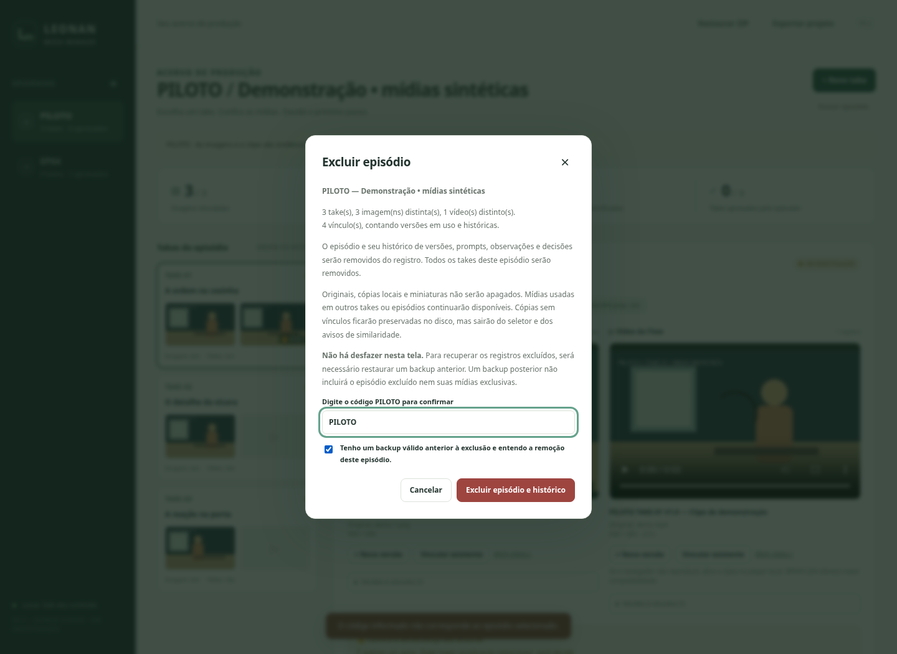

# Exclusão segura na V0.2

Exclusão é uma ação manual sobre os **registros** do acervo. Nenhuma operação de exclusão da V0.2 apaga arquivos de mídia, miniaturas, pastas ou o banco SQLite.

## Episódio

Selecione o episódio e use **Excluir episódio**, ao lado das ações do episódio. A janela mostra código e título, quantidade de takes, imagens/vídeos distintos vinculados e total de vínculos incluindo o histórico. Um mesmo arquivo usado em várias versões conta uma vez como mídia distinta; seus vários vínculos aparecem no total.

A janela explica a remoção dos takes e do histórico, a preservação de mídias compartilhadas e a necessidade de backup. É preciso **digitar o código exato** do episódio, confirmar que tem backup válido e clicar em **Excluir episódio e histórico**. Abrir a janela, cancelar, apertar Escape ou informar o código errado não exclui o registro.

## Take

No painel do take, use **Excluir este take**. Confira o episódio, o número e a descrição curta exibidos. Confirme o backup e clique no botão que identifica o take, por exemplo **Excluir TAKE-04**. Só esse take e seus vínculos são removidos. Os demais mantêm números, versões, decisões, prompts e observações.

Não há renumeração automática. Um episódio pode permanecer com uma lacuna, por exemplo TAKE-04 e TAKE-08, ou sem takes.

## Confirmação e transação

O servidor confere a confirmação, o alvo e o conteúdo apresentado na janela. A confirmação expira em dez minutos e fica inválida após exclusão ou reinício do servidor. Se um take, versão ou vínculo envolvido mudou, é preciso reabrir a janela e conferir novamente. Uma solicitação repetida não pode excluir um novo registro que reutilize o mesmo identificador SQLite.

As remoções de vínculos, takes e episódio são feitas na mesma transação, com chave estrangeira ativa. Erros de banco são apresentados na janela; não são tratados como sucesso. Se houver erro, atualize o acervo e confira os registros antes de tentar novamente. A aplicação continua sendo destinada a uma única instância por pasta de dados.

## Mídias compartilhadas e órfãs

Uma mídia continua na biblioteca e na similaridade enquanto **qualquer vínculo ativo ou histórico** permanecer em outro take. Desvincular uma versão em uso também não apaga o histórico: esse vínculo histórico continua protegendo e mantendo a mídia disponível.

Sem vínculos restantes, a mídia fica **órfã**. Seus bytes, miniatura e registro técnico em `assets` continuam preservados localmente, mas deixam de aparecer em **Vincular existente** e nos avisos de similaridade. Um seletor antigo não pode recriar o vínculo de uma mídia que acabou de ficar órfã; atualize a tela. Uma importação manual do mesmo arquivo pode criar novo vínculo reutilizando a cópia já existente.

O ganho nesta versão é retirar testes e cadastros excluídos das listas, **não liberar espaço em disco**. Não há botão ou rotina de limpeza física. Uma limpeza futura exigirá tarefa e autorização específicas, backup restaurado e conferência de todas as referências ativas e históricas. Não apague arquivos SHA-256 nem registros SQLite manualmente.

## Backup e recuperação

Não há botão **Desfazer**. Para recuperar um episódio/take e seu histórico, é necessário um backup **anterior** à exclusão. A janela pede que o operador confirme esse pré-requisito; o aplicativo não certifica sozinho que um backup externo foi restaurado e testado.

Um backup novo exporta os episódios e takes ainda presentes, todo o histórico restante e as mídias que eles referenciam. **Órfãos ficam fora do ZIP novo** e não reaparecem na biblioteca quando esse backup é restaurado. Um backup posterior não recupera registros já excluídos. A cópia integral de `data`, feita com o aplicativo fechado, continua sendo o meio de preservar também os arquivos órfãos.

Restauração continua aditiva: não sobrescreve episódios existentes e usa sufixos em códigos repetidos. Para testar recuperação integral, restaure em uma pasta de dados vazia. Os formatos de banco e de backup da V0.1 foram preservados.

Se preferir adiar uma exclusão, **cancele** e conserve o backup anterior. A V0.2 não implementa lixeira/arquivamento com restauração por um clique. Isso evita apresentar a preservação de bytes órfãos como se fosse preservação do histórico excluído.
